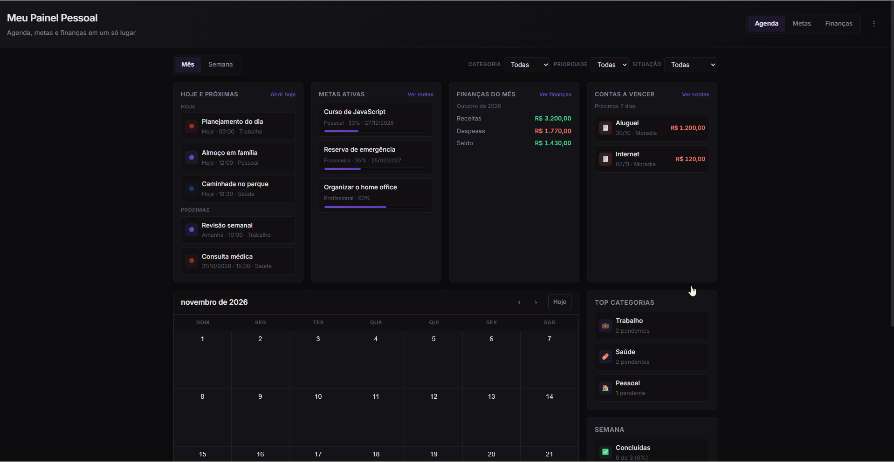
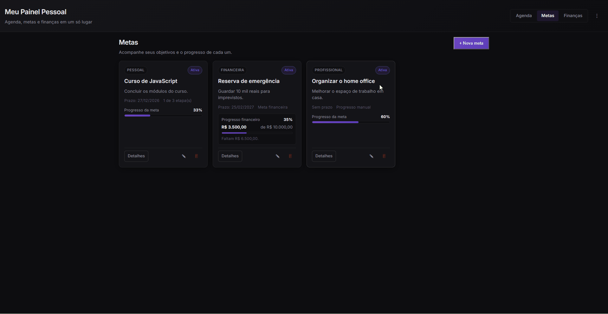
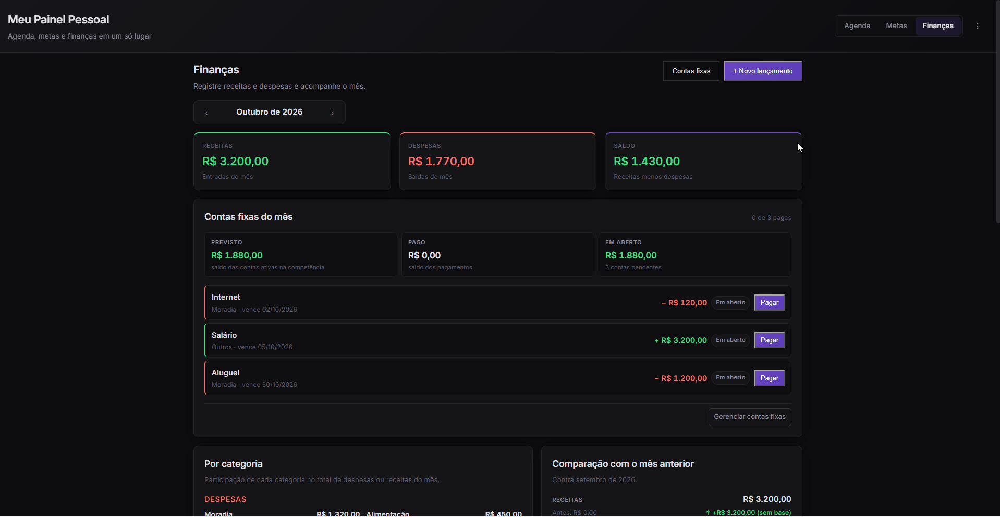

# Agenda

**Organização pessoal em um só lugar.**

Uma aplicação web para organizar tarefas, compromissos, metas e finanças pessoais. O projeto nasceu da ideia de reunir essas atividades em um único ambiente, com uma interface simples e regras de negócio implementadas em JavaScript.

[Ver código-fonte](https://github.com/SabrinaGamaa/Agenda) · [LinkedIn](https://linkedin.com/in/sabrina-gama/)

---

## Sobre o projeto

O Agenda reúne diferentes áreas da organização pessoal em uma única aplicação, permitindo acompanhar atividades do dia a dia, planejar objetivos e visualizar informações financeiras.

Mais do que uma interface de calendário, o projeto trabalha com regras para recorrência de tarefas, controle de datas, cálculos monetários e persistência dos dados no navegador.

A aplicação foi desenvolvida com HTML, CSS e JavaScript, utilizando módulos nativos e sem frameworks de interface.

## Funcionalidades

**Agenda e tarefas**
- Visualizações de calendário por mês, semana e dia.
- Cadastro e organização de tarefas.
- Regras para atividades recorrentes.
- Tratamento de alterações pontuais em ocorrências.
- Suporte a tarefas que atravessam a meia-noite.
<p align="center">
  <!-- GIF 1: CALENDARIO -->
  
</p>

**Metas**
- Criação e acompanhamento de objetivos.
- Organização por etapas.
- Acompanhamento do progresso.
- Suporte a metas financeiras.
<p align="center">
  <!-- GIF 1: META -->
  
</p>


**Finanças pessoais**
- Registro de receitas e despesas.
- Organização de contas fixas e pagamentos.
- Relatórios e comparações financeiras.
- Estimativas de despesas e saldo futuro.
<p align="center">
  <!-- GIF 1: FINANÇAS -->
  
</p>


**Outros recursos**
- Armazenamento local dos dados.
- Exportação e importação de dados.
- Testes automatizados para módulos de regras de negócio.

## Decisões técnicas

### Organização do código

O código foi dividido em módulos com responsabilidades distintas, separando componentes de interface, telas, regras de negócio e acesso aos dados.

Essa organização facilita localizar funcionalidades, testar comportamentos específicos e modificar partes do sistema sem concentrar toda a lógica em um único arquivo.

### Regras de negócio

As regras relacionadas a datas, recorrências, tarefas e finanças ficam em módulos próprios. Isso permite validar comportamentos sem depender diretamente da interface visual.

### Cálculos financeiros

Os valores monetários são tratados em centavos inteiros nos cálculos apropriados, evitando problemas comuns de representação de números decimais em JavaScript.

### Testes

O projeto inclui testes para módulos como datas, recorrência, tarefas, metas e cálculos financeiros.

Os testes podem ser utilizados para verificar comportamentos esperados e identificar regressões durante a evolução do código.

## Tecnologias

- **HTML5:** estrutura da aplicação.
- **CSS3:** estilos, layout e temas.
- **JavaScript (ES Modules):** funcionalidades e regras de negócio.
- **Git e GitHub:** versionamento e publicação do código.

## Estrutura do projeto

```text
Agenda/
├── index.html
├── css/
│   ├── estilo.css
│   └── tema-escuro.css
├── js/
│   ├── app.js
│   ├── componentes/
│   ├── dados/
│   ├── regras/
│   ├── telas/
│   └── ...
└── testes/
    ├── armazenamento.test.js
    ├── datas.test.js
    ├── dinheiro.test.js
    └── ...
```

## Como executar

É necessário utilizar um servidor HTTP local para carregar corretamente os módulos JavaScript.

Com Python instalado, execute na pasta do projeto:

```bash
py -m http.server 5500
```

Depois, acesse:

`http://localhost:5500`

Para acessar a interface de testes, abra:

`http://localhost:5500/testes/testes.html`

## Próximos passos

O projeto continua em evolução. Entre os objetivos estão aprimorar a experiência em dispositivos móveis, validar os fluxos de dados e ampliar a cobertura de testes.

## Autora

**Sabrina Gama**

Estudante de Análise e Desenvolvimento de Sistemas, interessada em desenvolvimento de software e na construção de aplicações que resolvam problemas do cotidiano.

- [GitHub](https://github.com/SabrinaGamaa)
- [LinkedIn](https://linkedin.com/in/sabrina-gama/)
